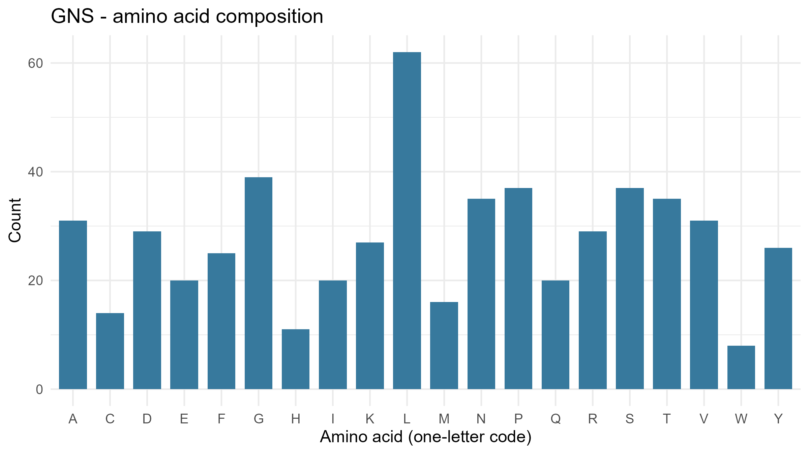
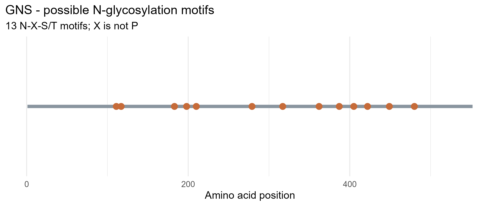

# Exploring Lysosomal Enzymes Using NCBI and R

**Cell and Molecular Biology Laboratory**

**Name:** Ijan, Shane Mae B.  
**Section:** A  
**Selected Gene:** GNS  
**Enzyme:** N-acetylglucosamine-6-sulfatase  
**Organism:** *Homo sapiens*

-----

## 1. Protein Information

This laboratory activity focused on the sequence analysis of human N-acetylglucosamine-6-sulfatase (GNS), a lysosomal enzyme involved in the degradation of glycosaminoglycans. GNS plays an important role in lysosomal digestion by removing specific sulfate groups from complex molecules, particularly heparan sulfate, allowing their stepwise breakdown.

### Table 1. General Information and Biological Function of the Human GNS Enzyme

| **Required Information** | ** GNS Enzyme** |
|---|---|
| Gene name | GNS (glucosamine (N-acetyl)-6-sulfatase) |
| Enzyme name | N-acetylglucosamine-6-sulfatase |
| NCBI protein accession | NP_002067.1 |
| What it breaks down | Heparan sulfate, a type of glycosaminoglycan. The enzyme also participates in the degradation of heparin and keratan sulfate. |
| Normal function | N-acetylglucosamine-6-sulfatase removes specific sulfate groups from heparan sulfate, allowing its stepwise breakdown inside lysosomes. |

Table 1 presents the general information and biological function of the human GNS enzyme, including its gene name, enzyme name, and NCBI protein accession. N-acetylglucosamine-6-sulfatase is a lysosomal enzyme involved in the catabolism of glycosaminoglycans, particularly heparan sulfate, as well as heparin and keratan sulfate. Its primary function is to remove specific sulfate groups from these molecules, allowing their stepwise breakdown within lysosomes. This process is essential for the proper catabolism of complex molecules and the prevention of their accumulation inside cells.

**NCBI Protein Record:** https://www.ncbi.nlm.nih.gov/protein/NP_002067.1 

-----

## 2. Results and Interpretation

### 2.1. Protein Sequence Summary

The amino acid sequence of human N-acetylglucosamine-6-sulfatase (GNS) was retrieved from the NCBI Protein database using the RefSeq accession number NP_002067.1. The sequence was analyzed using R to determine its total length, amino acid composition, and potential N-glycosylation motifs.

**Table 2. Summary of the Human GNS Protein Sequence Analysis**

| Parameter | Result |
|---|---|
| Gene | GNS |
| NCBI protein accession | NP_002067.1 |
| Protein length | 552 amino acids |
| Potential N-glycosylation motifs | 13 |

Table 2 summarizes the results of the GNS protein sequence analysis. The protein consists of 552 amino acids and contains 13 potential N-glycosylation motifs. These motifs follow the N-X-S/T sequence pattern, where X represents any standard amino acid except proline. Their presence indicates potential sites for N-linked glycosylation, although the analysis does not confirm whether these sites are actually glycosylated.

### 2.2. Amino Acid Composition

The amino acid composition of the GNS protein was analyzed to determine the frequency and percentage of each of the 20 standard amino acids in its sequence.

**Table 3. Five Most Abundant Amino Acids in the Human GNS Protein**

| Amino Acid | Count | Percentage |
|---|---:|---:|
| Leucine (L) | 62 | 11.23% |
| Glycine (G) | 39 | 7.07% |
| Proline (P) | 37 | 6.70% |
| Serine (S) | 37 | 6.70% |
| Asparagine (N) | 35 | 6.34% |

Table 3 presents the five most abundant amino acids in the human GNS protein. Leucine (L) was the most abundant, with 62 residues (11.23%), followed by glycine (G) with 39 residues (7.07%). Proline (P) and serine (S) each had 37 residues (6.70%), while asparagine (N) accounted for 35 residues (6.34%). These findings indicate that leucine is the most frequently occurring amino acid in the 552-residue GNS sequence.

**Figure 1. Amino Acid Composition of the Human GNS Protein.** The bar graph illustrates the distribution of the 20 standard amino acids in the 552-amino-acid sequence of human N-acetylglucosamine-6-sulfatase (GNS). The x-axis represents the amino acids using their one-letter codes, while the y-axis shows the number of residues.

Figure 1 shows that leucine (L) had the highest frequency, with 62 residues (11.23%), followed by glycine (G) with 39 residues (7.07%). Proline (P) and serine (S) each accounted for 37 residues (6.70%), while asparagine (N) had 35 residues (6.34%). In contrast, tryptophan (W) was the least abundant, with 8 residues (1.45%). The variation in bar heights demonstrates an uneven distribution of amino acids, with leucine being the most prevalent residue in the GNS protein sequence.

### 2.3. Identification of Potential N-Glycosylation Motifs

The GNS protein sequence was examined for potential N-glycosylation motifs using the N-X-S/T sequence pattern, where N represents asparagine, X represents any standard amino acid except proline, and S/T represents serine or threonine.

**Table 4. Potential N-Glycosylation Motifs Identified in the Human GNS Protein**

| Amino Acid Position | Motif |
|---:|---|
| 111 | NNT |
| 117 | NCS |
| 183 | NYT |
| 198 | NYS |
| 210 | NVS |
| 279 | NSS |
| 317 | NNT |
| 362 | NQT |
| 387 | NKT |
| 405 | NLT |
| 422 | NVT |
| 449 | NNT |
| 480 | NLT |

Table 4 presents the positions and sequences of the 13 potential N-glycosylation motifs identified in the human GNS protein. The first motif was located at position 111 (NNT), while the last was found at position 480 (NLT). All identified motifs followed the N-X-S/T sequence pattern. These findings indicate the presence of multiple potential N-linked glycosylation sites distributed along the protein sequence.

**Figure 2. Distribution of Potential N-Glycosylation Motifs in the Human GNS Protein.** The horizontal gray line represents the 552-amino-acid protein sequence, while the orange markers indicate the starting positions of the 13 potential N-glycosylation motifs.

Figure 2 illustrates the distribution of the 13 potential N-glycosylation motifs along the GNS protein sequence. The motifs were identified at positions 111, 117, 183, 198, 210, 279, 317, 362, 387, 405, 422, 449, and 480. The earliest motif was detected at position 111, while the last occurred at position 480. Several motifs appeared relatively close together, particularly at positions 111–117 and 183–210. The distribution indicates multiple potential sites for N-linked glycosylation throughout the protein. However, these motifs represent computational predictions and do not confirm actual glycan attachment or the presence of mannose-6-phosphate tags.

-----

## 3. Questions and Answers

### 1. What does your enzyme normally break down inside lysosomes?

N-acetylglucosamine-6-sulfatase (GNS) is a lysosomal enzyme involved in the catabolism of glycosaminoglycans, particularly heparan sulfate. It also participates in the degradation of heparin and keratan sulfate. GNS removes sulfate groups from specific N-acetylglucosamine residues, allowing these complex molecules to undergo further breakdown within lysosomes. This process is essential for the normal degradation and recycling of cellular materials (National Center for Biotechnology Information, n.d.).

### 2. What is the total length of your protein, and which amino acids are most common?

Based on the R sequence analysis, the human GNS protein (NP_002067.1) consists of 552 amino acids. Leucine (L) was the most abundant amino acid, with 62 residues (11.23%), followed by glycine (G) with 39 residues (7.07%). Proline (P) and serine (S) each contained 37 residues (6.70%), while asparagine (N) and threonine (T) each accounted for 35 residues (6.34%). These results indicate that leucine is the most frequently occurring amino acid in the GNS protein sequence.

### 3. How many potential N-glycosylation motifs did you find? Where are they located?

The R analysis identified 13 potential N-glycosylation motifs in the GNS protein sequence. These motifs were located at amino acid positions 111, 117, 183, 198, 210, 279, 317, 362, 387, 405, 422, 449, and 480. All identified motifs followed the N-X-S/T pattern, where X represents any standard amino acid except proline. Their distribution indicates multiple potential sites for N-linked glycosylation along the protein sequence, although their presence does not confirm actual glycan attachment.

### 4. Why can glycosylation matter for lysosomal proteins? Does finding a motif prove the protein is glycosylated?

Glycosylation is important for many lysosomal proteins because it contributes to proper protein folding, stability, and intracellular transport. Certain lysosomal enzymes undergo mannose-6-phosphate (M6P) modification on their N-linked glycans, which allows them to be recognized by M6P receptors and transported to lysosomes (Braulke et al., 2024). However, identifying an N-X-S/T motif does not prove that a protein is glycosylated. The motif only represents a potential site for N-linked glycosylation, and experimental evidence is necessary to confirm actual glycan attachment or M6P modification. Therefore, sequence analysis alone cannot establish whether a particular motif is glycosylated.

### 5. What could happen in the cell if your enzyme did not work properly?

If GNS does not work properly, heparan sulfate cannot be completely degraded and may accumulate inside lysosomes. This accumulation disrupts normal lysosomal function and can interfere with cellular processes, particularly in nerve cells. Deficiency of GNS is associated with mucopolysaccharidosis type IIID (Sanfilippo syndrome D), a lysosomal storage disorder characterized by progressive neurological deterioration and developmental difficulties. These effects demonstrate the importance of GNS in maintaining normal lysosomal catabolism and cellular function (National Library of Medicine, 2010).

-----

## 4. References

Braulke, T., Carette, J. E., & Palm, W. (2024). Lysosomal enzyme trafficking: From molecular mechanisms to human diseases. *Trends in Cell Biology, 34*(3), 198–210. https://doi.org/10.1016/j.tcb.2023.06.005

National Center for Biotechnology Information. (n.d.). *GNS glucosamine (N-acetyl)-6-sulfatase [Homo sapiens (human)] (Gene ID: 2799).* National Library of Medicine. https://www.ncbi.nlm.nih.gov/gene/2799

National Center for Biotechnology Information. (n.d.). *N-acetylglucosamine-6-sulfatase precursor [Homo sapiens] (NP_002067.1).* National Library of Medicine. https://www.ncbi.nlm.nih.gov/protein/NP_002067.1

National Library of Medicine. (2010, August 1). *GNS gene.* MedlinePlus Genetics. https://medlineplus.gov/genetics/gene/gns/
